# CreditFlow — simulador e esteira de crédito

Simula empréstimos (Price e SAC), analisa o risco por uma cadeia de regras, aprova ou recusa e, se aprovado, contrata de forma idempotente gerando o cronograma de parcelas.

Stack: Java 21, Spring Boot 3.3, PostgreSQL + Flyway, `BigDecimal`/`MathContext`, Resilience4j, JUnit 5, WireMock, JaCoCo, Docker, GitHub Actions.

## Demonstração

Price (parcela fixa) vs SAC (parcela decrescente), dados reais devolvidos pela API (R$ 10.000, 1,99% a.m., 12x):

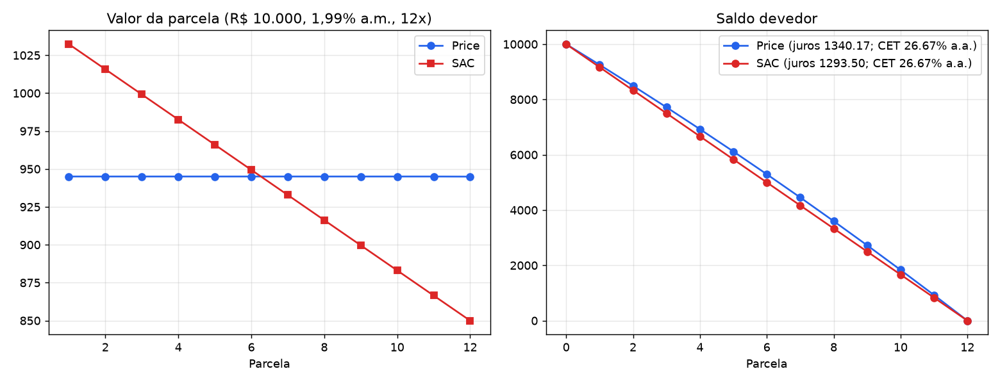

Resultado dos testes automatizados (`mvn verify`):

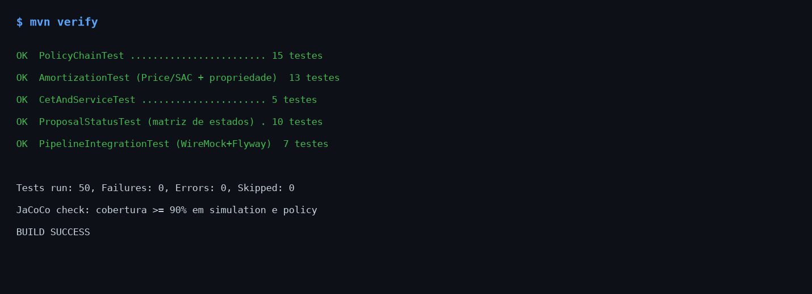

Teste ponta a ponta com `docker compose` (PostgreSQL + WireMock) e teste de concorrência:

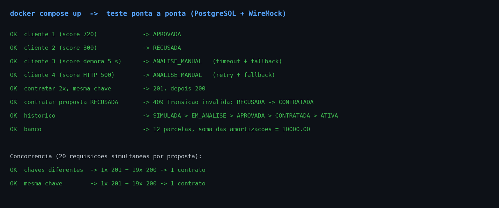

Documentação interativa da API (Swagger UI em `http://localhost:8080/swagger-ui/index.html`, captura real do navegador):

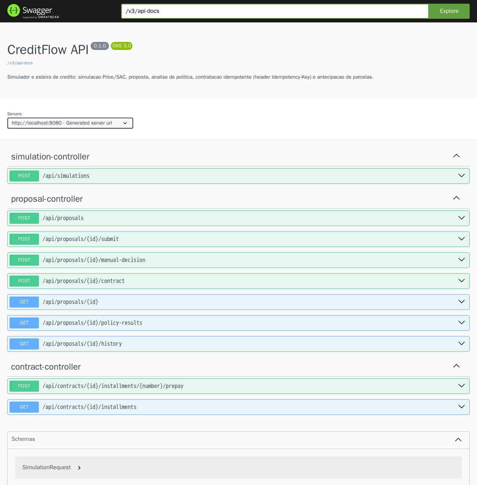

> Os gráficos usam a saída real da API; os painéis de teste são um resumo formatado dos resultados reais.

## Como rodar

```bash
cp .env.example .env              # defina as senhas (o .env nunca é versionado)
docker compose up --build        # app em 127.0.0.1:8080; PostgreSQL e mock do score (WireMock) só na rede interna do Compose
mvn verify                       # testes + JaCoCo (falha se cobertura de simulation/policy < 90%)
```

## Autenticação

A API usa HTTP Basic (stateless). Contas em memória, com senhas vindas do `.env`:

- `analyst` (`ANALYST_PASSWORD`): acessa tudo e é o único que decide a análise manual.
- `customer-1` … `customer-4` (`CUSTOMER_PASSWORD`): cada cliente só vê e contrata as próprias propostas. Recurso de outro cliente responde 404.

Em produção a identidade viria de um provedor OIDC e o tráfego passaria por TLS.

## Modo demonstração (para avaliar sem senha)

Um comando sobe tudo, com banco, mock do score e dados de exemplo, e a tela de login ganha botões de entrada com um clique (Cliente, Cliente com score instável e Analista). Não precisa de `.env`:

```bash
docker compose -f docker-compose.demo.yml up --build
# abra http://localhost:8080 e clique em "Entrar como Cliente" ou "Entrar como Analista"
docker compose -f docker-compose.demo.yml down -v   # para encerrar e limpar
```

Já vem com 6 propostas fictícias em estados diferentes: ativa com contrato, aprovada, recusada, duas em análise manual e uma só simulada.

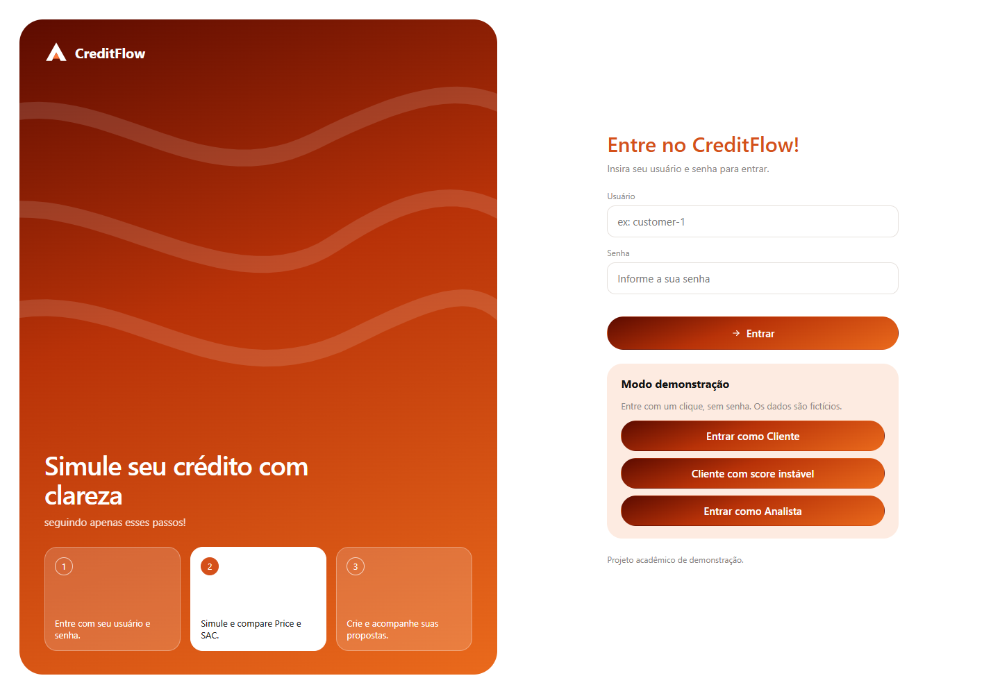

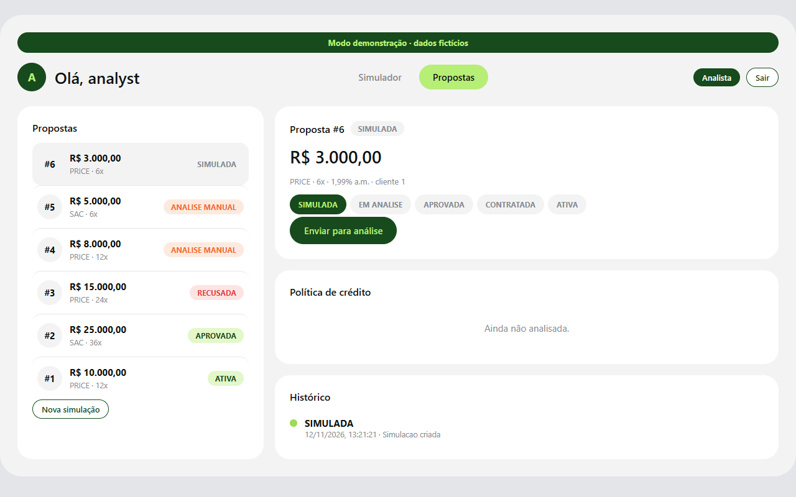

> **Aviso:** o modo demonstração publica as credenciais de exemplo em `GET /api/demo`. Ele só existe quando `CREDITFLOW_DEMO_ENABLED=true` (somente no `docker-compose.demo.yml`, ligado a `127.0.0.1`) e deve ser usado apenas localmente. O `docker-compose.yml` normal continua exigindo senha.

## Demonstração online na Vercel (JavaScript estático)

Importe o repositório na Vercel sem alterar o diretório raiz: o `vercel.json` aponta `outputDirectory` para `src/main/resources/static`, sem build. Sem backend Java, o `assets/demo.js` simula a API no navegador (mesmos cálculos em aritmética exata, mesma política, dados de exemplo e score instável simulado; estado em `localStorage`). Se houver backend, o demo se desliga e a interface usa a API real. É uma vitrine: não é o serviço real e as credenciais de demonstração são públicas. Testes: `node --test src/test/js/*.test.js`.

## Interface web

Com a aplicação no ar, abra **http://localhost:8080** e entre com `customer-1` (senha `CUSTOMER_PASSWORD` do `.env`) ou `analyst` (`ANALYST_PASSWORD`).

- **Simulador:** Price ou SAC, parcelas, juros totais, CET aproximado e gráfico de composição.
- **Propostas:** cria a proposta a partir da simulação, envia para análise, mostra o resultado de cada regra da política, o histórico de estados e, depois da contratação, o cronograma com antecipação de parcelas. O analista também decide as análises manuais.
- A tela da Idempotency-Key tem o botão "Repetir pedido (mesma chave)": devolve o mesmo contrato, sem duplicar.

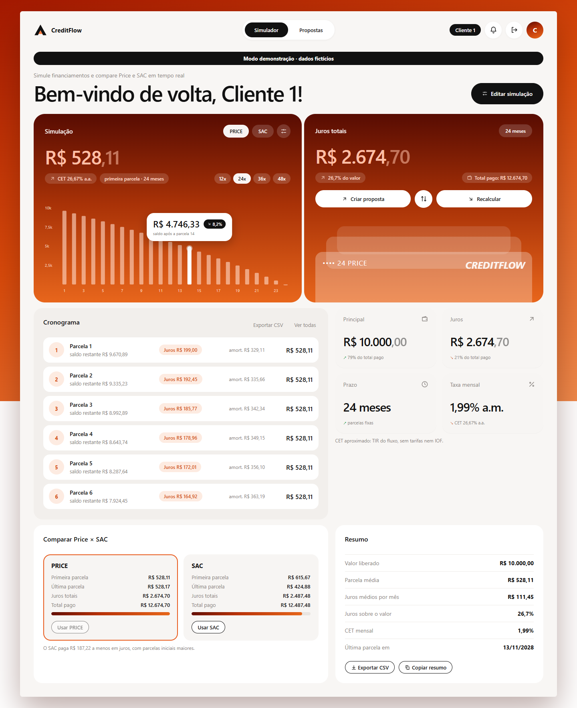

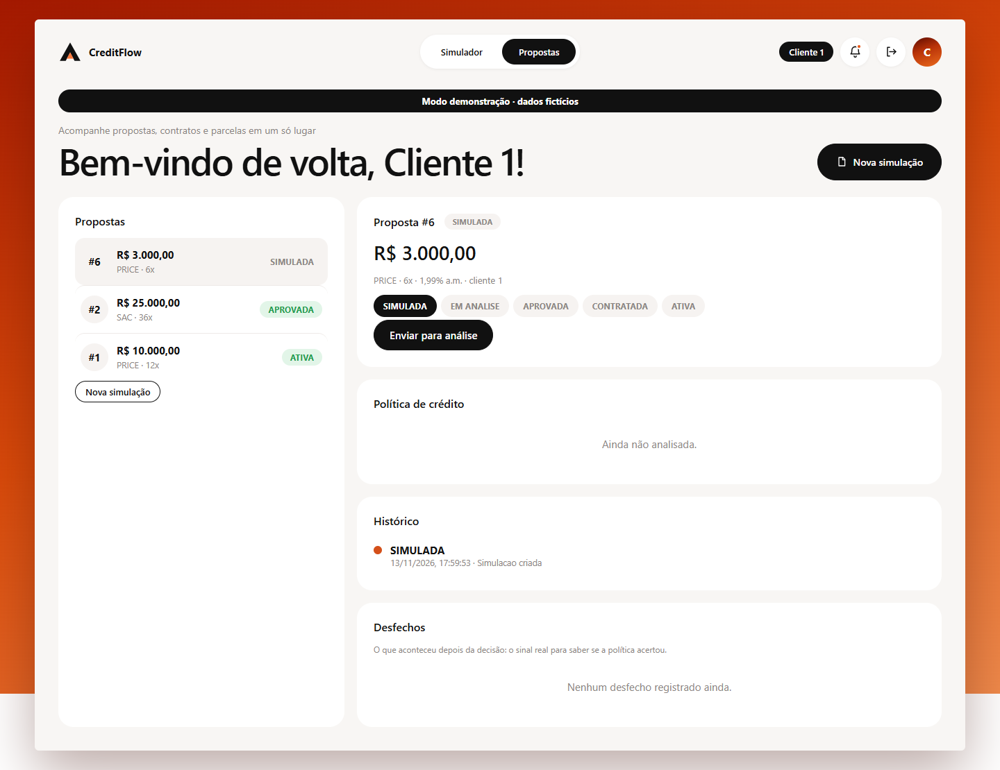

Front-end em HTML, CSS e JavaScript puros, sem dependências nem CDN, servido pelo próprio Spring Boot com Content-Security-Policy restritiva. As credenciais ficam só na memória da página (nada em cookie, `localStorage` ou `sessionStorage`).

Fluxo de exemplo:

```bash
AUTH="customer-1:$CUSTOMER_PASSWORD"

# 1. simulação (sem persistir)
curl -u "$AUTH" -X POST localhost:8080/api/simulations -H 'Content-Type: application/json' \
  -d '{"system":"PRICE","amount":10000,"monthlyRate":0.0199,"term":12}'

# 2. criar proposta (SIMULADA), 3. enviar para análise
curl -u "$AUTH" -X POST localhost:8080/api/proposals -H 'Content-Type: application/json' \
  -d '{"customerId":1,"system":"SAC","amount":10000,"monthlyRate":0.0199,"term":12,"monthlyIncome":8000,"existingCommitments":0,"relationshipMonths":24}'
curl -u "$AUTH" -X POST localhost:8080/api/proposals/1/submit

# 4. contratar (idempotente: repetir devolve o mesmo contrato)
curl -u "$AUTH" -X POST localhost:8080/api/proposals/1/contract -H 'Idempotency-Key: abc-123'
```

Swagger UI: `http://localhost:8080/swagger-ui/index.html` (OpenAPI em `/v3/api-docs`). Fica desligado por padrão e é ligado só no `docker-compose.yml` (`SWAGGER_UI_ENABLED=true`).

Demais endpoints: `GET /api/proposals/{id}`, `/history`, `/policy-results`, `POST /{id}/manual-decision` (só analista), `GET /api/contracts/{id}/installments`, `POST /api/contracts/{id}/installments/{n}/prepay`.

O mock do score (`wiremock/mappings/score.json`) devolve 720 por padrão; cliente `2` → score 300 (recusa), cliente `3` → resposta com 5 s de atraso (timeout), cliente `4` → HTTP 500. Os dois últimos caem em `ANALISE_MANUAL`.

## Decisões de precisão

- Valores monetários: `BigDecimal` com **scale = 2** e **`RoundingMode.HALF_EVEN`** (arredondamento bancário). Nunca `double`.
- Cálculos intermediários: `MathContext` de 34 dígitos (DECIMAL128). Centralizado em `common/Money`.
- Juros de cada parcela = `round(saldo × i)`. **A última parcela absorve o resíduo** de arredondamento (amortização = saldo restante), então o saldo final é sempre exatamente `0.00`.
- Price usa `PMT = PV·i·(1+i)ⁿ / ((1+i)ⁿ − 1)` (equivalente a `PV·i / (1 − (1+i)⁻ⁿ)`); SAC usa `A = PV/n`, `Pₖ = A + (PV − (k−1)·A)·i`.
- Valor mínimo: 0,01 por parcela (`amount ≥ term × 0,01`), para não existir amortização arredondada a zero.
- `HALF_EVEN` importa: ex. 1000 a 2% a.m. em 3x tem juros de 13,465 na 2ª parcela → 13,46.

## CET (aproximação)

O CET informado é a **TIR** do fluxo (valor liberado contra as parcelas pagas), calculada por bisseção em `BigDecimal`, mensal e anualizada `(1+i)¹²−1`. **É uma aproximação**: não inclui tarifas, seguros nem IOF, como exige o CET regulamentado pelo Banco Central. Sem encargos, o CET é igual à taxa do contrato (coberto em teste).

## Máquina de estados

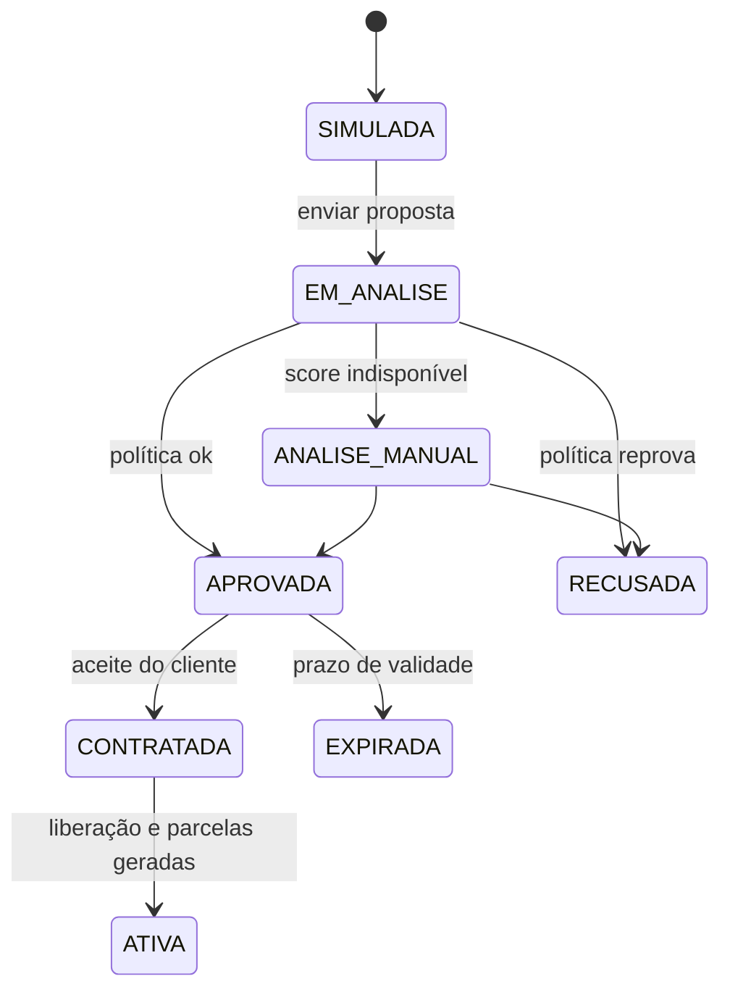

- `Proposal.transitionTo` é o único ponto de mudança de status; transições fora do diagrama lançam `InvalidTransitionException` (HTTP 409). Contratar uma proposta recusada é impossível.
- `proposal_history` é imutável (`@Immutable`, só inserção); cada mudança registra origem, destino, motivo e instante.
- `@Version` na proposta evita atualizações concorrentes silenciosas.
- Propostas `APROVADA` com validade vencida são expiradas por job diário (`ProposalService.expireOverdue`) e não podem ser contratadas.

## Política de crédito (Chain of Responsibility)

`MIN_INCOME → INCOME_COMMITMENT → RELATIONSHIP → SCORE`. Cada elo (`PolicyHandler`) passa adiante (`PASS`), recusa (`REJECT`) ou envia para análise manual (`MANUAL`); se todos passam, aprova. Cada avaliação e seu motivo ficam em `credit_policy_result`. A chamada externa (score) é a última, e a cadeia para na primeira recusa, então regras baratas evitam a chamada. Limites configuráveis em `creditflow.policy.*` (em produção, via Parameter Store).

### Versão da política em cada decisão

Cada resultado de regra grava a **versão da política** que o produziu (`pol-xxxxxxxx`). A versão é calculada sozinha: é o hash das regras, da ordem delas e dos limites. Se alguém mudar um limite (renda mínima, comprometimento, tempo de relacionamento ou score), a versão muda, sem depender de alguém lembrar de atualizá-la. Assim dá para saber exatamente qual política aprovou ou recusou cada proposta, mesmo depois de ela mudar. Decisões anteriores a esse recurso aparecem como `legacy`.

## Desfechos e qualidade da política

A decisão sozinha não diz se estava certa. O sistema registra também o **desfecho posterior** de uma proposta, ligado à decisão original e à versão da política:

| Desfecho | Quando se aplica |
| --- | --- |
| `CONTESTACAO` | Proposta já decidida (aprovada, recusada, contratada, ativa ou expirada) |
| `CHARGEBACK`, `INADIMPLENCIA`, `QUITACAO` | Só proposta `ATIVA`, com contrato |

Só o analista registra (`POST /api/proposals/{id}/outcomes`); o cliente vê os desfechos das próprias propostas (`GET`). Os registros são imutáveis (só inserção). Cada desfecho é classificado:

- **Possível falso positivo:** aprovou, mas houve inadimplência ou chargeback.
- **Possível falso negativo:** recusou, mas o cliente contestou a decisão.
- **Decisão confirmada:** aprovou e o cliente quitou normalmente.

`GET /api/outcomes/summary` (só analista) cruza versão da política × decisão × desfecho, e a aba **Qualidade** da interface mostra o mesmo. A contestação do cliente é um sinal barato: mede onde a política errou sem precisar de uma equipe grande de revisão manual. A ideia veio de um feedback recebido sobre o projeto.

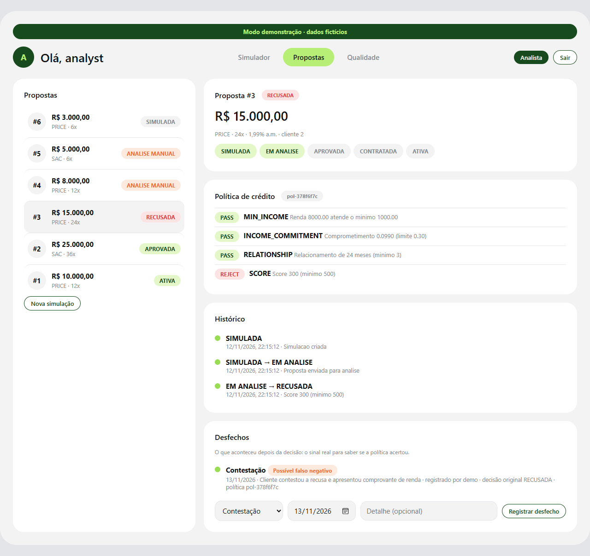

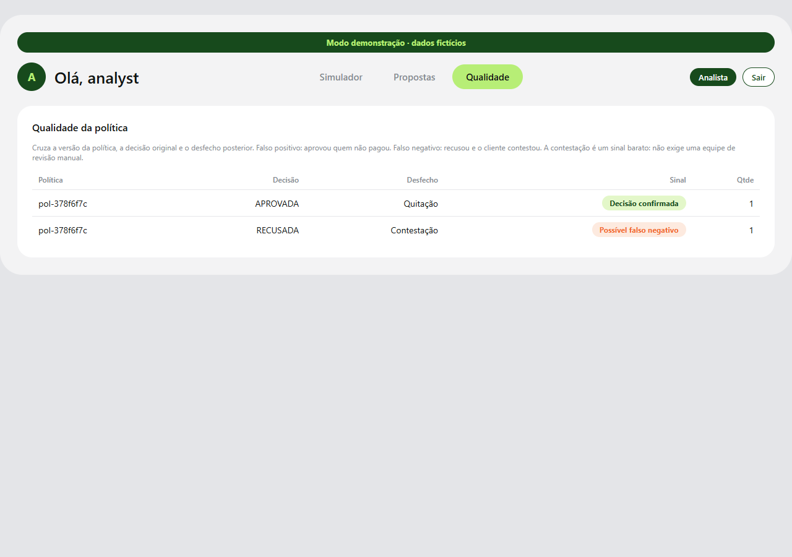

Limites assumidos: o sinal é indicativo (uma contestação pode ser infundada), os desfechos são lançados manualmente (não há integração com um adquirente) e o relatório é uma contagem, não uma métrica estatística de acurácia.

## Serviço de score instável

`HttpScoreClient`: timeouts de conexão/leitura, `@Retry` do Resilience4j (3 tentativas, 200 ms) e fallback que devolve vazio → `ScoreRule` retorna `MANUAL` → proposta vai para `ANALISE_MANUAL`. A chamada fica fora de transação de banco para não segurar conexão durante timeouts.

## Contratação idempotente

1. `Idempotency-Key` já usada na mesma proposta → devolve o contrato existente (200). Em outra proposta → 409.
2. Proposta já contratada com outra chave → devolve o contrato existente.
3. Corrida entre requisições simultâneas: `UNIQUE(proposal_id)`, `UNIQUE(idempotency_key)` e `@Version`; quem perde relê o contrato vencedor.

## Antecipação (opcional)

Desconto simples pro rata sobre a parcela: `valor = parcela / (1 + i·dias/30)`, nunca abaixo da amortização. Aproximação de estudo.

## Testes

- Tabelas parametrizadas de Price e SAC com valores esperados (confira com `=PGTO()` na planilha).
- Propriedade (1000 cenários com semente fixa): soma das amortizações = valor financiado e saldo final = 0, com scale 2.
- Matriz de transições de estado completa; cadeia de política com cenários de fronteira.
- Integração (H2 em modo PostgreSQL + Flyway + WireMock): fluxo completo, idempotência, score com erro 500 e timeout, retry limitado, proposta recusada não contratável.
- JaCoCo exige ≥ 90% de linhas em `simulation` e `policy` (`mvn verify`).

## AWS (alvo de deploy)

ECS Fargate + RDS PostgreSQL; parâmetros de política (`POLICY_*`) e credenciais vindos do Systems Manager Parameter Store como variáveis de ambiente da task; logs no CloudWatch. Não incluído como IaC neste repositório.
